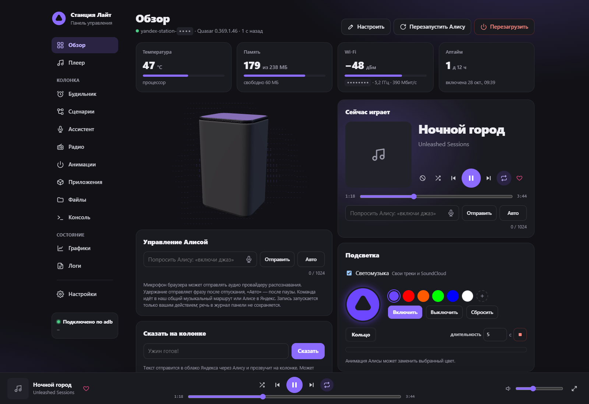
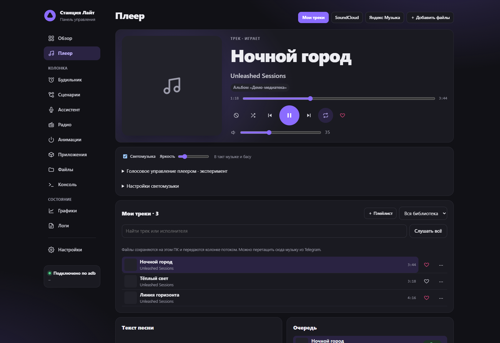
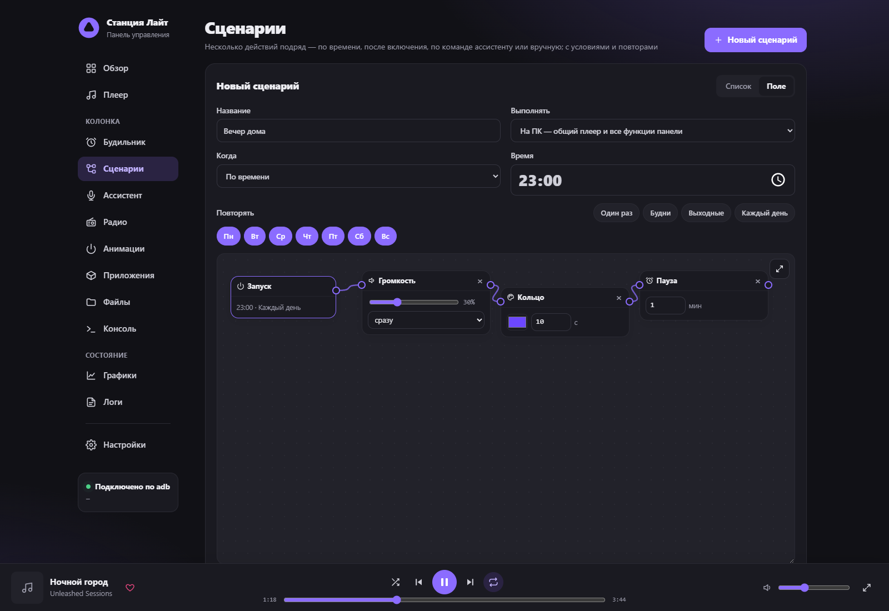

<div align="center">

# Yandex Station Unleashed

**Музыка, свет и сценарии для вашей Яндекс Станции.**

Локальная панель · своя медиатека · SoundCloud · светомузыка

[Возможности](#возможности) · [Быстрый старт](#быстрый-старт) · [Совместимость](#совместимость) · [Авторы](#авторы-и-лицензии)


</div>



<table>
  <tr>
    <td width="50%"></td>
    <td width="50%"></td>
  </tr>
  <tr>
    <td align="center">Общий плеер и своя музыка</td>
    <td align="center">Сценарии с условиями и действиями</td>
  </tr>
</table>

> Скриншоты сняты с интерфейса этой версии на демонстрационных данных. Треки, показатели и сценарии — примеры; личные данные владельца не используются.

Неофициальный форк **[dimap/yandex-station-web](https://github.com/dimap/yandex-station-web)** от **[Chekpoinss](https://github.com/Chekpoinss)**. Сохранена основа оригинала и добавлены собственная библиотека, SoundCloud, светомузыка и отдельный профиль Станции Лайт первого поколения. Применимые части интерфейса перенесены из upstream v0.2.0. Это самостоятельная модификация, а не оригинальный релиз.

## Возможности

| | Что умеет панель |
|---|---|
| **Музыка** | Один плеер для Яндекс Музыки, своих файлов и SoundCloud. Очередь, плейлисты, любимые, повтор, перемешивание и перемотка. Любимые треки и альбомы Яндекса. |
| **Медиатека** | Файлы и обложки хранятся на компьютере, звук идёт потоком через штатный Glagol/mediad. Поиск в библиотеке и публичных записях SoundCloud. |
| **Подсветка** | Анимации, цвета и светомузыка для своих файлов и SoundCloud. FFT-анализ, реакция на бас, палитры и профили. Приоритет индикации Алисы и будильника. |
| **Сценарии** | Визуальный редактор с условиями, ожиданиями и ветвлениями. Запуск вручную, по расписанию или голосовой фразе; выполнение на ПК или автономно на колонке. |
| **Будильники** | Расписание, собственные звуки и подготовка музыкального фрагмента для автономного запуска. Без нарастания громкости. Доступность зависит от профиля и демона. |
| **Голос** | Микрофон браузера для команд и отдельный голосовой мост общего плеера. Управление музыкой и поиск в медиатеке. |
| **Устройство** | 3D-модель, состояние, Bluetooth, графики, файлы, логи, консоль и пакеты YAM. |
| **Оформление** | Светлая и тёмная темы, акцент, перестановка виджетов, адаптивный интерфейс и PWA. |

Радио, ассистент и редактор анимаций адаптированы из оригинала. Компоненты на колонку устанавливаются отдельно; наличие вкладки не означает, что компонент уже установлен. GPT по умолчанию не включён.

## Быстрый старт

Нужна **уже рутированная Станция с доступом по adb**, компьютер в той же сети и **Python 3.9+**. Для zstd-анимаций — Python 3.14+ либо утилита zstd. Для музыкальных функций нужен **FFmpeg**, для SoundCloud и метаданных — пакеты из `requirements-local.txt`.

### Windows

1. Скачайте [исходники форка](https://github.com/Chekpoinss/yandex-station-unleashed/archive/refs/heads/main.zip) и распакуйте архив.
2. Запустите **`start.bat`**. Он предложит загрузить недостающие Python, adb и FFmpeg в папку `runtime`.
3. Для медиатеки и SoundCloud установите дополнительные пакеты из папки проекта:

   ```powershell
   python -m pip install --target runtime/packages -r requirements-local.txt
   ```

   Здесь `python` — установленный Python с pip. Портативный Python из `start.bat` не содержит pip: используйте обычный Python, устанавливая пакеты в ту же папку `runtime/packages`.

4. Укажите адрес колонки при первом запуске. Откройте **[localhost:8765](http://127.0.0.1:8765/)**.

### Linux / macOS

Установите Python, adb и FFmpeg. Из папки проекта:

```sh
python3 -m venv .venv
. .venv/bin/activate
python -m pip install -r requirements-local.txt
python server.py --device <IP_КОЛОНКИ> --model lite1 --open
```

`lite1` — Лайт первого поколения. Для другой модели выберите её профиль или `auto`. Аргументы: `python server.py --help`.

### Docker

В `docker-compose.yml` задайте адрес колонки и выполните:

```sh
docker compose up -d --build
```

Образ собирается из **исходников этого форка**. Настройки сохраняются в `./data`, медиатека — в `./data/music-data` внутри того же тома. Для аудиопотока используется порт 8767. На Linux предусмотрен `network_mode: host`; Docker Desktop требует отдельной настройки сети и адреса потока, доступного колонке.

## Совместимость

| Профиль | Модель | Особенности |
|---|---|---|
| `lite1` | Лайт, 1-е поколение | Отдельный профиль форка: музыка, подсветка, адаптированный локальный будильник. Дисплея нет. |
| `lite2` | Лайт 2 | Базовый профиль оригинала: часы, подсветка, заставка и будильники. |
| `mini3pro` | Мини 3 Про | Часы и кольцо; загрузочные функции и будильник выключены. |
| `station2` | Станция 2 | Без часов; загрузочные функции и будильник выключены. |
| `mini3` | Мини 3 | Экспериментальный профиль; запись подсветки выключена. |

Доступность зависит от профиля и прошивки. Новые сценарии, голосовые маршруты, анимации и автономное развёртывание требуют проверки на конкретной колонке. Проверка всех функций на всех моделях не заявляется.

Несколько колонок: скопируйте `speakers.example.json` в `speakers.json`, задайте устройства и запустите `python multi.py --config speakers.json --data-dir data/multi --port 8765`. Данные и медиатеки экземпляров изолированы.

## Что стоит знать

- Панель **не получает root**. Консоль и файловый менеджер используют уже имеющийся доступ.
- По умолчанию сервер слушает `127.0.0.1`. При доступе из сети задайте пароль; не открывайте панель напрямую в интернет.
- Яндекс Музыка требует входа. SoundCloud работает через yt-dlp; доступность записей зависит от сервиса и сети.
- Светомузыка анализирует **свои файлы и SoundCloud**. Штатная Яндекс Музыка и Bluetooth не анализируются.
- Музыкальным действиям сценариев нужен работающий ПК. Автономный звук будильника готовится отдельно, длина — до пяти минут.
- Автоматические уведомления об обновлениях оригинала отключены. Обновляйте форк вручную: замена исходниками upstream может удалить доработки.
- После замены Python-файлов перезапустите сервер панели: обновление страницы не загружает новый backend.

## Данные и состав

В репозитории — исходники, ресурсы интерфейса, лицензии, инструкции, тесты и три скриншота. Python, adb, FFmpeg, зависимости и сборки создаются или скачиваются локально.

Токены, пароли, сертификаты, адрес выбранной колонки, журналы, личная музыка, обложки, настройки света и пользовательские сценарии **не входят в публикацию**. Они исключены через `.gitignore`.

## Проверки

```sh
python -m unittest discover -s tests -v
node tests/test_renderer.mjs
node tests/test_paths.mjs
node tests/test_player020.cjs
node tests/test_extensions_ui.cjs
node tests/test_music_timeline.cjs
node tests/test_voice_input.mjs
node tests/test_update_ui.cjs
node tests/test_catalog.cjs
```

Проверки кода не заменяют испытания звука и функций на устройстве. Рекомендации по проверке моделей: [CONTRIBUTION.md](CONTRIBUTION.md).

## Авторы и лицензии

Основа — **[dimap/yandex-station-web](https://github.com/dimap/yandex-station-web)**. Поддержка моделей и нескольких колонок в оригинале — вклад **[chelaxian](https://github.com/chelaxian)**. Собственные дополнения форка — **[Chekpoinss](https://github.com/Chekpoinss)**.

- Код панели — [MIT](LICENSE), исходное уведомление об авторских правах сохранено.
- STL Лайт 2 — [модель vanyabeat](https://www.thingiverse.com/thing:7349611), **CC BY-SA 4.0**. Атрибуция моделей: [static/models/SOURCES.md](static/models/SOURCES.md).
- three.js, xterm.js и QR Code Generator включены с сохранением лицензий. Тексты песен — [LRCLIB](https://lrclib.net), пакеты — [yam / yapkg](https://github.com/nyakokitsu/yam).
- Протокол Glagol и QR-вход — по мотивам [AlexxIT/YandexStation](https://github.com/AlexxIT/YandexStation).

«Яндекс», «Алиса» и «Яндекс Станция» — товарные знаки соответствующих правообладателей. Проект не связан с Яндексом.
